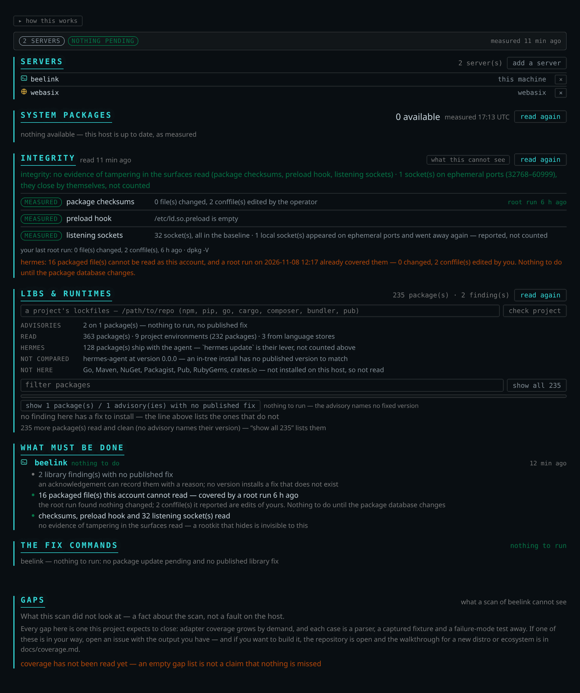

# Patch Sentinel

A Hermes plugin that answers **"are we patched?"** with evidence — for the machine Hermes runs on and
for any host it can reach over SSH — and hands you the exact commands to close what it finds.



The rule the whole thing is built on: **a check that could not look says so.** Every surface reports
*clean*, *finding* or *could not look*. An unreachable host, a rate-limited registry, a distro with no
reader: none of them is ever drawn as green.

## Install

```bash
git clone git@github.com:thebangarang/Patch-Sentinel.git ~/plugins/patch-sentinel
ln -s ~/plugins/patch-sentinel ~/.hermes/plugins/patch-sentinel
hermes plugins enable patch-sentinel
```

Restart the desktop app, open the plugin's pane, press **`scan all · <device>`**. Nothing has to be
configured: the inventory is this machine, the scan is read-only, and the registry and advisory lookups
are anonymous.

> **If you would rather use `hermes plugins install`:** installing from a git URL runs Hermes's
> admission scan, and this plugin is *made of* patch commands — the scan reports `privilege_escalation`
> on every string that says `sudo apt-get full-upgrade`, 189 findings, and **blocks** a community source
> until you pass `--force`. That is the product being what it claims to be, not a hidden capability: the
> pane runs nothing, and the one tool that can (`cve_apply`) runs `sudo -n` on a plan built from the
> host's own package manager. The clone + symlink above gives you the same plugin without the prompt.

To add machines, give the plugin `label=ssh-target` pairs (`local` is the machine Hermes runs on):

```yaml
plugins:
  entries:
    patch-sentinel:
      settings:
        hosts: "beelink=local,vps=webasix"
```

## The pane

One control, one device at a time. It reads the three surfaces **in the order the page draws them** —
system packages → integrity → libs & runtimes — then builds the commands. Every device keeps its own
last reading; switching devices never re-scans. A run takes ~60 s locally and 40–50 s over ssh, because
the surfaces are read one after another rather than at once: the section that animates is the section
being read, and two devices are never checked in a different sequence.

Below the readings the page answers two questions: **what must be done**, and **the fix commands** —
per device, numbered, with the risk, the downtime, how to verify each step and how to undo it. **`gaps`**
sits apart at the bottom: a caveat about the scan, not a step in it.

The pane changes nothing. It hands over commands, which is what an operator pastes into the terminal of
the device in front of them.

## What it reads

| surface | how it is read |
|---|---|
| **system packages** | the host's own manager — `apt`, `dnf`, `pacman`, `zypper`, `apk` — through its simulation output. Not filtered to `-security`: a fix shipped through `-updates` is still a fix |
| **running kernel** | running vs newest installed vs newest installable. A kernel package that is installed but not running is the commonest false clean there is |
| **vendor lag** | the advisory that names the fixed version, per family: Ubuntu notices, OSV per release (Debian, Alpine, RHEL family), Arch's tracker, Fedora's Bodhi, SUSE's OVAL. Where no feed exists the answer is *unmeasured*, never "no lag" |
| **container images** | tag → digest against the registry, anonymously. An image is never started |
| **integrity** | package checksums (`dpkg -V`, `rpm -Va`, `pacman -Qkk`, `apk audit`), `/etc/ld.so.preload`, and listening sockets against a recorded baseline. It never says "not compromised" — only what the surfaces it read did and did not show |
| **language stack** | nine ecosystems — npm, pip (global *and* every virtualenv), Packagist, RubyGems, crates.io, Maven, Go, NuGet, Pub — plus jars on disk and eight lockfile kinds, against OSV |
| **SBOM** | CycloneDX export of what was read, for the machine or one project |

Findings are split by **who can act**: the distro's own packages are patched by the distro, the agent's
environment by `hermes update`, and only the rest count as yours.

## The tools

| tool | what it does |
|---|---|
| `cve_scan` | pending updates, kernel currency, vendor lag, image drift — one host or all of them |
| `cve_rescan` | every surface of **one** device, in pane order, then the plan |
| `cve_plan` | the commands, with risk, downtime, verify and undo |
| `cve_explain` | one CVE or notice, from the vendor's own record |
| `cve_coverage` | what this run could see, and what it could not |
| `cve_libraries` | the language stack, machine-wide or for one project's lockfiles |
| `cve_integrity` | checksums, preload hook, sockets — read, re-baseline, or paste a root run |
| `cve_image` | what is inside one image, without starting it |
| `cve_sbom` | CycloneDX export |
| `cve_ack` | record a decision about one advisory, with a reason and an end date |
| `cve_apply` | the only tool that changes a machine: typed host name, `sudo -n`, dry run by default, receipt afterwards |

## Exit codes

| code | meaning |
|---|---|
| `0` | nothing to do — and every surface was read |
| `1` | something to patch, as measured |
| `2` | something could not be looked at, and the answer says which and why |

A `2` is not a defect; it is the product. The scenario batch (19 situations, 175 assertions) exists to
hold that contract — it is what caught a run returning `2` with counts and no reason, which reads as a
complete scan.

## What is verified, and on which machine

| family | packages | integrity | vendor lag | proven on |
|---|---|---|---|---|
| Ubuntu 26.04 | apt | `dpkg -V` | Ubuntu notices | this machine (beelink), live |
| Ubuntu 26.04 | apt | ssh read | — | a VPS (webasix), live |
| Debian 12 | apt | `dpkg -V` | OSV `Debian:12` | lab VM, live |
| Fedora 45 | dnf | `rpm -Va` | Bodhi | lab VM, live — 114 pending, 3-step plan |
| Arch | pacman | `pacman -Qkk` | Arch tracker | lab VM, live |
| openSUSE Leap 15.6 | zypper | `rpm -qf` | SUSE OVAL | **command-level only**: Leap ships python 3.6, the plugin needs 3.10+, so the family is not proven end to end |
| Alpine | apk | `apk audit` | OSV `Alpine:*` | **not registered**: the adapter is unit-tested against captured output, but every headless image refused the key. Such a host answers `unsupported`, with its name |
| RHEL / Rocky / Alma / Amazon | dnf | `rpm -Va` | OSV per release | adapter tested against captured payloads; no live host in the lab yet |

The four rows above Debian's caveat were read by copying the plugin onto the VM and running it with the
distro's own `python3` — the arrangement a fresh machine has, without Hermes.

### Where this stops, and how it grows

The rows marked **not verified** are not a disclaimer, they are a queue. Coverage grows by demand: each
distro family or ecosystem is a parser, a captured fixture and a failure-mode test, and the gap list in
the pane is the roadmap.

- **If one of these is in your way**, open an issue with the output you have — a `zypper -q lu`, a
  `pacman -Qkk`, an Alpine `apk version` — and the case gets built against it. Real demand decides the
  order.
- **If you would rather build it**, the repository is open and the work is well-bounded:
  `docs/coverage.md` describes how every surface was proven and what a capture looks like, and
  `tests/fixtures/` holds the ones already read. A new family is a reader, a fixture, and the test that
  proves it fails loudly when the source changes shape.

Nothing is missing because it was decided against; it is missing because nobody has sent the output
yet.

## No credential path

Registry and advisory reads are anonymous; remote hosts use **your own SSH agent**, so `ssh` sees the key
and the plugin never does. No secret is stored, read or forwarded, and the only thing sent anywhere is
package names and versions — to OSV, the vendor feeds and the registries. `sudo` prompts are not handled:
`cve_apply` runs only where `sudo -n` works, and otherwise refuses with the commands to run by hand. See
[`SECURITY.md`](SECURITY.md).

## Limits, stated

- **CVEs inside image layers** are not scanned — that needs an image scanner. Digest drift is measured;
  "these CVEs are fixed" is not claimed.
- **A project without a lockfile** is not covered: a range is not a version. Eight lockfile kinds are
  parsed; a manifest alone is reported as uncovered rather than guessed at.
- **A host with no language toolchain** reads as could-not-look, not clean — a bare VPS is the normal
  case, and the sentence says which tools were absent and what to check.
- **macOS and Windows** answer `unsupported` with the OS name.
- **It is not an EDR.** Integrity compares files, the preload hook and sockets against a baseline; a
  rootkit that hides from the package manager is invisible to it.

## Development

```bash
python3 -m unittest discover -s tests -t .   # 348 tests
python3 scripts/scenario_batch.py            # 19 situations, 175 assertions
./scripts/pane_check.sh                      # renders every panel, both states
hermes plugins validate .                    # manifest, tools, config schema
./scripts/preview_pane.sh [--fast] [device]  # HTML + PNG of the pane, outside the repo
python3 scripts/portability_probe.py         # run the plugin on a foreign host, per-surface report
```

Stdlib only. The long version of this file lives in [`docs/reference.md`](docs/reference.md); the
verified matrix per surface is [`docs/coverage.md`](docs/coverage.md), every decision including the
reversed ones is [`docs/design.md`](docs/design.md), and the commands that reproduce each claim are
[`docs/verify.md`](docs/verify.md).

## License

MIT.
